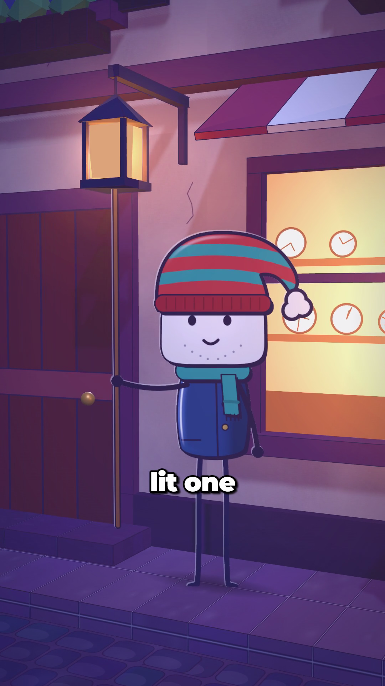
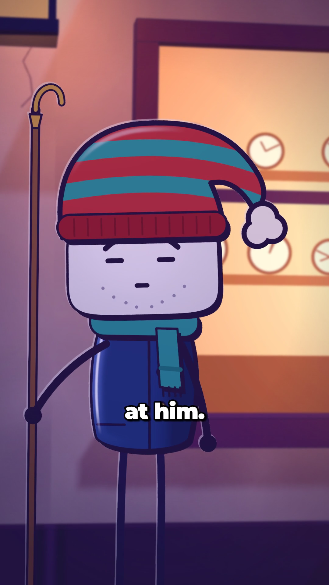
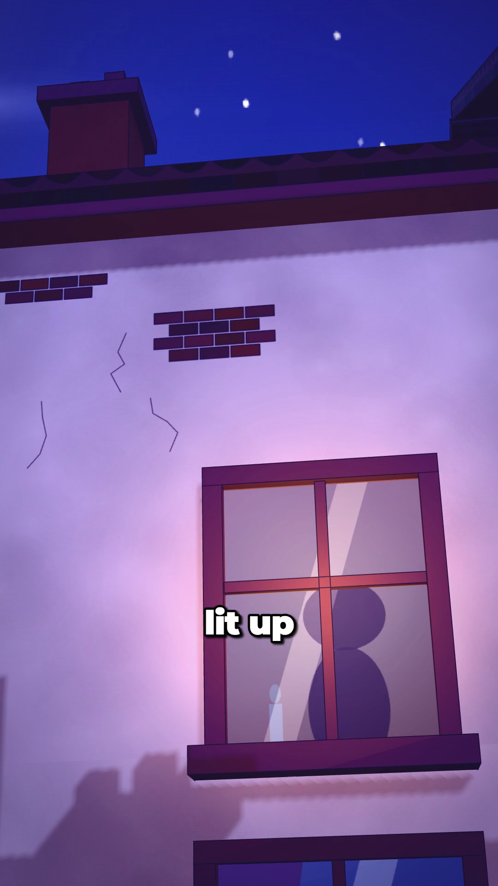
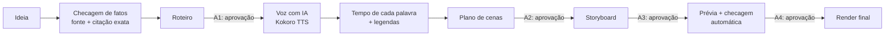

# Vídeos Animados com Agente de IA

Projeto pessoal: um **workflow com o agente de código Claude Code** que produz vídeos curtos animados (YouTube Shorts, 1080×1920, 35–60 s) do roteiro ao render final, com **checagem de fatos, voz por IA, controle de qualidade automático e aprovação humana** nas etapas críticas.

**Objetivo:** aprender, na prática, a orientar, avaliar e corrigir um agente de IA em um projeto real e complexo.

<p>
  
  
  
</p>

---

## Como funciona



- **11 etapas**, com **4 pontos de aprovação humana** (A1–A4) antes das etapas mais custosas. O agente só avança com uma aprovação explícita.
- **Ciclo de feedback:** eu descrevo um problema e o segundo do vídeo ("no segundo 4 o rosto fica rosa"). O agente localiza o frame e o arquivo de código, registra um item técnico em `feedback.md` e, depois da minha aprovação, aplica a correção e mostra o antes/depois.
- **Avaliação objetiva do output:** o estilo de 20 vídeos de referência foi transformado em métricas (ritmo da fala, duração dos planos, câmera, legendas, brilho). Um script reprova automaticamente renders fora do padrão e detecta falhas visuais (flicker).

## O que eu construí

| Parte | O que é |
|---|---|
| **2 skills customizadas** para o Claude Code | [`generate-animated-shorts`](.claude/skills/generate-animated-shorts/SKILL.md) produz o vídeo de ponta a ponta; [`explain-find-feedback`](.claude/skills/explain-find-feedback/SKILL.md) explica o projeto e converte feedback em itens técnicos |
| **Comando `/feedback`** | [Aplica](.claude/commands/feedback.md) só os itens de feedback que eu aprovei |
| **Evals das skills** | Casos de teste com critérios de avaliação em [`evals/`](.claude/skills/generate-animated-shorts/evals/) |
| **Engenharia de contexto** | [`CLAUDE.md`](CLAUDE.md) curto + [mapa do projeto](docs/PROJECT_MAP.md): o agente carrega só o contexto necessário em cada tarefa |
| **Ferramentas em Python** | Desenvolvidas com o agente, com testes unitários ([`tools/`](tools/)): checagem de fatos e do roteiro, voz, legendas, mixagem de áudio, controle de qualidade |
| **Animação** | Personagens 2D em um mundo 3D, desenhados em código com Remotion + three.js ([`src/`](src/)) |

**Meu papel:** definir os requisitos e as regras, tomar as decisões de estilo e de projeto (registradas em [`PLAN.md`](PLAN.md)), revisar e aprovar cada etapa e validar os resultados. O código foi escrito em conjunto com o agente.

### Principais ferramentas

| Grupo | Ferramentas | O que fazem |
|---|---|---|
| Conteúdo | `source_text.py`, `script_check.py` | Confere cada citação do roteiro com a fonte; verifica as regras do roteiro |
| Voz e áudio | `tts_kokoro.py`, `voice_words.py`, `make_captions.py`, `mix_audio.py` | Voz por IA, tempo de cada palavra, legendas sincronizadas, mixagem |
| Vídeo | `build_props.py`, `storyboard.py`, `new_set.py` | Plano de cenas → render, um frame por plano, novos cenários a partir de um modelo |
| Qualidade | `check_render.py`, `flicker.py`, `regress_frames.py`, `set_review.py` | Mede o vídeo contra o estilo aprovado, detecta flicker, evita que mudanças de código quebrem o visual |
| Feedback | `feedback_frames.py` | Extrai o frame citado no feedback e gera a imagem de antes/depois |

## Tecnologias

Python • TypeScript • Claude Code (Agent Skills) • Remotion • React • three.js • Kokoro TTS • ffmpeg • Git

## Estrutura

| Pasta | Conteúdo |
|---|---|
| `.claude/` | Skills, comando `/feedback` e evals |
| `src/` | Código da animação (personagens, cenários, câmera, legendas) |
| `tools/` | Ferramentas em Python e testes (`tools/tests/`) |
| `videos/` | Um diretório por vídeo: ideia, fatos, roteiro, plano de cenas, relatórios de checagem e feedback |
| `style_lock/` | O estilo visual aprovado e suas métricas |
| `docs/PROJECT_MAP.md` | Mapa completo do projeto |

## Como rodar

```bash
npm install
npm run studio
```

As ferramentas em Python rodam a partir da raiz do projeto, em um ambiente virtual (`.venv`). Arquivos de mídia (vídeos, áudio, músicas, pacotes 3D) não estão no repositório. Material de referência de terceiros (frames e transcrições dos vídeos analisados) também não está incluído: ficam só as métricas extraídas deles.

## Créditos

Pacotes 3D gratuitos (CC0) da Kenney e da Quaternius: veja [`references/sets/CREDITS.md`](references/sets/CREDITS.md). Voz: Kokoro-82M (Apache 2.0).
